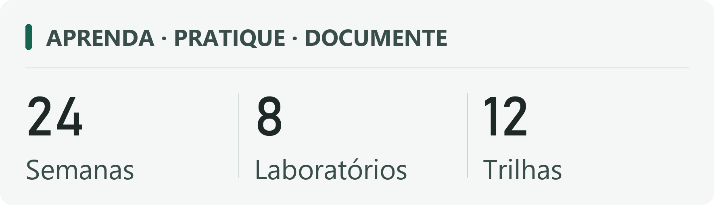

# Cybersecurity Roadmap BR

**Trilhas gratuitas em português, com laboratórios e modelos de relatório.**

Comece por fundamentos, escolha uma área e documente o que você observou em cada prática. O plano de 24 semanas organiza o percurso. O Study OS registra o progresso no próprio navegador e permite exportar um backup em JSON.

<picture>
  <source media="(prefers-color-scheme: dark)" srcset="docs/img/resumo-escuro.png">
  
</picture>

[Abrir Study OS](https://raphaelguterres.github.io/cybersecurity-roadmap-br/) · [Primeiros passos](START-HERE.md) · [Plano de 24 semanas](ROADMAP.md)

## Trilhas de estudo

- **Base** · [Fundamentos](trilhas/00-fundamentos.md) · [Redes e sistemas](trilhas/01-redes-sistemas.md) · [Programação](trilhas/02-programacao.md)
- **Defesa e investigação** · [SOC e Blue Team](trilhas/03-soc-blue-team.md) · [DFIR](trilhas/07-dfir.md) · [Threat intelligence](trilhas/09-threat-intelligence.md)
- **Aplicações e infraestrutura** · [AppSec](trilhas/04-appsec.md) · [Pentest ético](trilhas/05-pentest-etico.md) · [Cloud e DevSecOps](trilhas/06-cloud-devsecops.md) · [GRC e IAM](trilhas/08-grc-iam.md)
- **Desenvolvimento profissional** · [Carreira](trilhas/10-carreira.md) · [Engenharia de software](trilhas/11-dev-engineering.md)

## Da leitura à prática

Os laboratórios trazem requisitos, escopo e critérios de conclusão. Use o modelo de relatório para guardar a hipótese, o teste e o resultado. O painel também reúne desafios e um quiz de revisão. [Laboratórios](labs/README.md) · [Desafios](challenges/README.md) · [Modelo de relatório](labs/modelo-relatorio.md)

A biblioteca prioriza documentação das organizações e autores que mantêm cada referência. [Biblioteca](RECURSOS.md) · [Áreas de desenvolvimento](DEV_AREAS.md) · [Vídeos atribuídos](videos/README.md)

## Comunidade

Você pode começar revisando um link, relatando um erro ou propondo um exercício. As rodas de estudo são assíncronas e a participação é voluntária. [Portal da comunidade](https://raphaelguterres.github.io/cybersecurity-roadmap-br/community.html) · [Primeira contribuição](PRIMEIRA_CONTRIBUICAO.md) · [Grupos de estudo](GRUPOS_DE_ESTUDO.md) · [Discussões](https://github.com/raphaelguterres/cybersecurity-roadmap-br/discussions)

## Projeto aberto

O Study OS é um site estático em HTML, CSS e JavaScript. O registro de estudos usa o armazenamento local do navegador. Exporte o backup antes de limpar os dados do site. [Executar localmente](site/README.md) · [Integração contínua](https://github.com/raphaelguterres/cybersecurity-roadmap-br/actions/workflows/quality.yml) · [Plano da versão 2.0](ROADMAP_V2.md)

[Como contribuir](CONTRIBUTING.md) · [Código de conduta](CODE_OF_CONDUCT.md) · [Reporte de segurança](SECURITY.md) · [Licença MIT](LICENSE)
